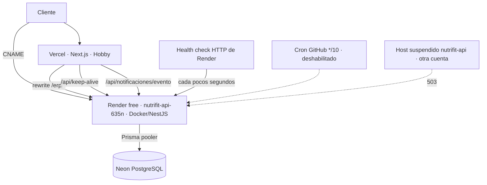

# Auditoría de consumo de Render — segunda revisión

**Fecha:** 2 de noviembre de 2026 (00:58–01:02 UTC, hora del servidor).
**Alcance:** auditoría de **solo lectura**. No se modificó código, configuración de producción, variables de entorno, despliegues, migraciones ni servicios de Render.
**Relación con la anterior:** corrige y amplía `docs/auditoria-consumo-render-2026-10-26.md`. La sección 7 corrige una conclusión de ese informe.

> **Nota de vigencia (04-11-2026).** Este documento es el registro de la investigación, no el
> estado actual. Sus afirmaciones se conservan tal como se escribieron; estas líneas dicen qué
> cambió después:
>
> | Afirmación en este documento | Estado al 04-11-2026 |
> |---|---|
> | §1.1 y §4.2: `healthCheckPath` = `/api/health` y **esa es la causa raíz** | El health check está **desactivado** (`''` desde las `01:10:23Z`, por API y autorizado por el dueño). La hipótesis quedó **refutada como causa suficiente**: tras un redeploy, la instancia siguió respondiendo en **1,06 s** a los **22 min** sin tráfico, cuando el umbral de reposo son 15 min |
> | §4.2: «no hace falta ningún usuario, bot ni cron» | **Refutado**. El sospechoso es un **cron externo de cron-job.org** que llama a `POST /api/deliveries/reminders/dispatch` **cada 15 min** (`delivery.service.ts:688`). No verificado: en el plan free no hay logs ni métricas de petición por API |
> | §4.3: el sondeo cada pocos segundos impide que Neon duerma | Con el health check fuera, Neon ya puede dormir entre pasadas del cron. **No verificado** en el panel de Neon |
> | §9 y §12: el plan de acción arranca cambiando el health check | El health check **ya se cambió y no bastó**. Sigue siendo necesario —si el cron despierta la instancia, un health check HTTP la mantendría despierta—, pero el ahorro depende de bajar la frecuencia del cron |
> | §11.3: arranque en frío imposible de medir mientras el health check mantenga la instancia despierta | La instancia **sigue sin dormir**, así que sigue sin poder medirse. No cambió la conclusión, cambió el motivo |
>
> El diagnóstico actualizado está en `docs/estado.md`, sección «el health check no era la causa».

---

## 1. Resumen ejecutivo

1. **La causa del consumo es el health check HTTP de Render.** Render sondea cada pocos segundos cada instancia *en ejecución*. Con una ruta HTTP configurada, el servicio nunca acumula los 15 minutos de inactividad que disparan el apagado automático, así que se mantiene despierto a sí mismo las 24 horas. No hace falta ningún usuario, bot ni cron.
2. **La cuota es de 750 horas por workspace y mes calendario.** Una instancia encendida todo el mes consume 720 h (30 días) o 744 h (31 días): entre el **96 % y el 99 %** de la cuota. En meses de 31 días quedan **6 horas** de margen.
3. **Los datos de la alerta lo confirman:** 618 h equivalen a 25 días y 18 horas de instancia encendida sin interrupción, y del 1 al 26 de octubre hay exactamente 25 días. Es **una** instancia, no dos, y no hay picos de tráfico.
4. **Supabase no participa en la ejecución.** No hay dependencias `@supabase/*` ni variables `SUPABASE_*` en el frontend ni en el backend; la base de datos es **Neon**. Sí existe un proyecto Supabase vinculado al repositorio mediante la integración de GitHub (la comprobación «Supabase Preview» aparece en cada PR, proyecto `xnrwoplnjqgcutzjyqso`), pero ninguna ruta del código lo consulta.
5. **Hallazgo nuevo:** existe un segundo servicio Render, `nutrifit-api.onrender.com`, que responde **503 «This service has been suspended»**. El servicio real es `nutrifit-api-635n.onrender.com`. Además, `nutrifit-api-staging` **no está desplegado** (404 genérico).
6. **Corrección al informe del 26-10:** el arranque de 96 segundos por el seed de estaciones **ya se corrigió** el 27-10 (commit `1546a4a`). Ver sección 7.
7. **El arranque está medido: 44 segundos** desde la creación de la instancia hasta que la app escucha, de los cuales **30 s son el pre-arranque** (`baseline.js` + `ensure-enum.js` + `prisma migrate deploy`, que se ejecuta en **cada** arranque). El cliente aborta a **45 s**. El margen es de un segundo. Ver sección 7.3.
8. **Consecuencia directa:** aplicar la Fase 1 tal como estaba planeada deja el checkout al borde del fallo. Antes hay que bajar el arranque o subir el abort. Ver sección 9.

---

## 1.1 Datos del panel, confirmados por API

Obtenidos con un workflow de GitHub Actions de **solo lectura** (`GET` a la API de Render, sin `PATCH` ni `DELETE`), ejecutado el 2-11-2026 a las 01:33 UTC sobre el commit `main` `2ebb6c2`. El workflow vive en la rama `chore/render-audit-readonly` (`.github/workflows/render-audit-readonly.yml`) y no se ha fusionado.

| Dato | Valor |
|---|---|
| Servicios en el workspace | **1** |
| Nombre / tipo | `nutrifit-api` · `web_service` |
| URL | `https://nutrifit-api-635n.onrender.com` |
| Estado | `not_suspended` |
| Plan / región | `free` · `virginia` |
| Instancias | `1` (fija, sin autoscaling) |
| Rama / autoDeploy | `main` · `yes` |
| `healthCheckPath` | **`/api/health`** |
| Instancia activa | 1, creada el **2026-10-30T01:51:22Z** |
| Último despliegue vivo | `dep-dbhvfs7b9u1s73b4h080`, commit `2ebb6c2`, 30-10-2026 01:52:15Z |

**Dos consecuencias que cambian el plan:**

1. **El servicio suspendido `nutrifit-api.onrender.com` no está en este workspace.** Hay un solo servicio y es `nutrifit-api-635n`. Ese host pertenece a otra cuenta: **no se puede eliminar y no consume horas de este workspace**. La Fase 5 del plan anterior queda cerrada como *no aplicable*.
2. **La instancia lleva encendida desde el 30-10 sin reiniciarse**, y los eventos de las últimas dos semanas son únicamente `build_started` / `deploy_*`, sin ningún `instance_stopped`. Es la firma de un servicio que nunca llega a dormir.

---

## 2. Evidencia recogida

| Comprobación | Método | Resultado |
|---|---|---|
| API de producción | `GET https://api.nutrifitsuplementos.cl/api/health` | **200**, 986 ms, 59 B, `{"status":"ok","db":"ok",...}` |
| Swagger en producción | `GET /api/docs` | **404** (cerrado, `ENABLE_SWAGGER` no está en `true`) |
| DNS del dominio | `Resolve-DnsName` | `nutrifitsuplementos.cl` → `76.76.21.21` (Vercel); `api.…` → CNAME `nutrifit-api-635n.onrender.com` |
| Servicio real | `GET https://nutrifit-api-635n.onrender.com/api/health` | **200**, cuerpo idéntico |
| Servicio homónimo | `GET https://nutrifit-api.onrender.com/api/health` | **503** «This service has been suspended» |
| Staging declarado | `GET https://nutrifit-api-staging.onrender.com/api/health` | **404** (igual que un host inexistente) |
| Control negativo | `GET https://zzz-no-existe-12345.onrender.com/api/health` | **404** (mismo cuerpo) |

Las cuatro peticiones a `onrender.com` fueron de diagnóstico, sin autenticación y sin efectos.

### 2.1 Segunda tanda: API de Render en solo lectura

El 2-11-2026 a las 01:33–01:37 UTC se ejecutó el workflow `.github/workflows/render-audit-readonly.yml` (rama `chore/render-audit-readonly`), que solo hace `GET`:

| Endpoint | Código | Uso |
|---|---|---|
| `GET /v1/services?limit=100` | 200 | Lista de servicios del workspace |
| `GET /v1/services/{id}` | 200 | `healthCheckPath`, plan, región, instancias |
| `GET /v1/services/{id}/deploys?limit=5` | 200 | Último despliegue vivo |
| `GET /v1/services/{id}/events?limit=40` | 200 | Eventos (solo build/deploy) |
| `GET /v1/services/{id}/instances` | 200 | Instancia activa y su fecha de creación |
| `GET /v1/owners` | 200 | `ownerId` para la consulta de logs |
| `GET /v1/logs?ownerId=…&resource=…` | 200 | Líneas de arranque (filtradas) |

Ninguna llamada fue `POST`, `PATCH` ni `DELETE`. El workflow no se ha fusionado a `main`.

---

## 3. Arquitectura verificada



| Conexión | Estado | Fuente |
|---|---|---|
| `nutrifitsuplementos.cl` → Vercel | Confirmada | DNS |
| `api.nutrifitsuplementos.cl` → Render | Confirmada | DNS + 200 |
| Render → Neon | Confirmada | `backend/src/prisma/prisma.service.ts` reescribe a `-pooler` |
| Vercel → Render (`/erp`) | Confirmada | `next.config.mjs` |
| Vercel → Render (`keep-alive`) | Confirmada, **sin llamador** | `src/app/api/keep-alive/route.ts` |
| Vercel → Render (notificaciones) | Confirmada | `src/app/api/notificaciones/evento/route.ts` |
| Supabase | **Fuera de la ruta de ejecución** | 0 dependencias y 0 variables; hay un proyecto vinculado al repo por la integración de GitHub que el código no usa |

---

## 4. Diagnóstico del consumo

### 4.1 La cuenta cierra con una sola instancia

- Cuota: **750 h/workspace/mes**; solo consume la instancia **mientras está encendida**; al agotar las horas, Render **suspende todos los servicios free** hasta el mes siguiente, sin acumular saldo (`https://render.com/docs/free`).
- 618 h = **25 días y 18 horas**.
- Del 1-10 al 26-10 hay **25 días**.
- Octubre (31 días) encendido 24/7 = **744 h**; quedan **6 h**.
- Dos servicios encendidos habrían consumido ~1.200 h. **No hay duplicados consumiendo.**

### 4.2 Causa raíz

El health check HTTP. Render lo documenta así: sondea «cada pocos segundos» las instancias **en ejecución** y las reinicia si no responden (`https://render.com/docs/health-checks`). Ese sondeo es tráfico entrante y reinicia el contador de inactividad, de modo que el servicio **nunca** llega a los 15 minutos y **nunca** se apaga.

**Confirmación empírica (2-11-2026):** el `healthCheckPath` del servicio es `/api/health` (§1.1) y la única instancia activa se creó el 30-10 a las 01:51:22Z y sigue siendo la misma tres días después. No hay ningún evento de parada en los 40 eventos más recientes. La instancia no se ha reciclado desde el último despliegue.

### 4.3 Riesgo colateral en Neon

`/api/health` ejecuta `SELECT 1`. Un sondeo cada pocos segundos impide que Neon aplique su apagado por inactividad (5 minutos). Neon free incluye **100 CU-hours por proyecto**; con el mínimo de 0,25 CU, tener la base despierta 720 h supone **~180 CU-hours**, por encima del límite. **Inferencia a verificar en el panel de Neon**: si el plan es free y la base no duerme, el límite se agota a mitad de mes.

---

## 5. Procesos innecesarios

| # | Proceso | Ubicación | Disparador | Impacto | Observación |
|---|---|---|---|---|---|
| 1 | Health check HTTP | Panel de Render | Render, cada pocos segundos | **Máximo**: impide el apagado 24/7 | Causa raíz |
| 2 | Cron keep-alive `*/10` | `.github/workflows/keep-alive.yml` | GitHub (deshabilitado en la UI) | 0 hoy; **total si se reactiva** | 10 min < 15 min. No borrar |
| 3 | Verificación en vivo | `.github/workflows/render-verify-live.yml` | Cada push a `main` | Sondea el **host equivocado** (suspendido): 20 intentos × 12 s por push | No valida el servicio real; gasta minutos de Actions |
| 4 | `/api/keep-alive` | `src/app/api/keep-alive/route.ts` | Nadie en el repo | 0 hoy | Puerta abierta |
| 5 | `/api/ping` | `backend/src/ping/ping.controller.ts` | Nadie en el repo | 0 hoy | Redundante con `/api/health` |
| 6 | Servicio suspendido `nutrifit-api.onrender.com` | Render (otra cuenta) | — | 0 h | **No está en este workspace** (§1.1): nada que eliminar |
| 7 | `autoDeploy` en cada push | `backend/render.yaml` | Git | No gasta horas; gasta build minutes (500/mes) | Blueprint nunca aplicado |

**Descartados como sospechosos:** el tráfico de la tienda (el catálogo sale de `src/data/seed.ts`), el service worker, el latido del frontend (eliminado: no hay `setInterval` en `src`) y los cron internos del backend (no hay `ScheduleModule` ni `@Cron`; el único `setInterval`, en `auth.controller.ts`, limpia un `Map` en memoria).

---

## 6. Qué depende obligatoriamente de Render

| Función | Depende | Detalle |
|---|---|---|
| Catálogo, home, ficha, FAQ, carrito | **No** | Datos locales del bundle |
| Crear pedido | **Sí** | `POST /api/orders` vía `/erp` |
| Validar cupón | **Sí** | vía `/erp` |
| Suscripción push | **Sí** | VAPID del backend |
| Webhook de notificaciones | **Sí** | Vercel → `/api/push/evento` |
| ERP, admin y POS | **Sí, 100 %** | Todo el panel |
| IA, OCR, compras, finanzas, recordatorios, Todoist | **Sí** | Solo admin |
| Reseñas | No | `src/lib/reviews.ts` no se usa en la UI |

La tienda pública necesita la API **solo al cerrar el pedido**; el ERP/POS la necesita mientras se opera.

---

## 7. Estado real del arranque (corrección)

El informe del 26-10 atribuyó 96 s de arranque al seed de estaciones, medido sobre el commit `3617079` (20-10). El 27-10 se corrigió:

```
1546a4a  perf(boot): sincronizar estaciones de metro solo si cambia el seed
         (143 upserts por arranque -> 2 consultas)
```

`DeliverySeedService.onModuleInit` ya no reescribe las 143 estaciones: compara `config.metro_seed_version` y `COUNT(*)` y, si coinciden, **no toca la tabla** (2 consultas). Solo resincroniza si se sube `METRO_SEED_VERSION` o si el conteo no cuadra.

**Lo que queda en el arranque:**

| Etapa | Qué hace | Coste |
|---|---|---|
| Pre-arranque (`Dockerfile` CMD) | `baseline.js` + `ensure-enum.js` + `npx prisma migrate deploy` | Proceso Node + CLI de Prisma + conexión a Neon |
| `DeliverySeedService` | 2 consultas (no-op habitual) | ~1 s |
| `OrdersService` | `MAX(orderNumber)` + upsert del contador + expirar abandonados | 3 consultas |
| `ProductsService` | Variantes con stock reservado (normalmente ninguna) | 1 consulta |
| `PurchasesService` | 2 × `CREATE TABLE IF NOT EXISTS` | 2 consultas |
| `TodoistService` | Ya no bloquea el arranque | 0 |
| `PrismaService` | Conexión lazy | 0 |
| Swagger | Solo si `ENABLE_SWAGGER=true` | 0 en producción |

### 7.3 Arranque medido en producción (2-11-2026)

Los logs de arranque del despliegue del 30-10 se obtuvieron con `GET /v1/logs` (ventana 01:49–01:57 UTC). El seed **no** resincronizó:

```
01:52:02 [DeliverySeedService] Metro stations al dia (v2026-10-27.1, 143 estaciones) - sin sincronizar
01:52:03 [DeliverySeedService] Delivery settings already seeded (11)
01:52:04 [DeliverySeedService] Delivery window synced: 08:00-22:00
01:52:06 [NestApplication] Nest application successfully started
01:52:06 [Bootstrap] Listening on http://0.0.0.0:10000/api (health: /api/health)
```

Confirma en producción la corrección de `1546a4a`: la sincronización de las 143 estaciones **no** ocurre en cada arranque.

**Cronología completa del arranque:**

| Momento (UTC, 30-10) | Hito | Delta |
|---|---|---|
| 01:51:22 | Render crea la instancia | — |
| 01:51:52 | `[Bootstrap] Startup: NODE_ENV=production PORT=10000` | **+30 s** |
| 01:51:53 | `PrismaModule` y `HealthModule` inicializados, rutas mapeadas | +1 s |
| 01:52:00 | `Prisma: modo lazy (sin $connect en arranque)` | +7 s |
| 01:52:02 | Metro stations al día (no-op) | +2 s |
| 01:52:06 | `Nest application successfully started` + `Listening on :10000` | +4 s |
| 01:52:15 | `deploy_ended` (health check superado) | +9 s |

**Resultado: 44 s desde la creación de la instancia hasta que la app escucha; 53 s hasta que Render da el despliegue por terminado.**

El tramo dominante son los **30 s previos a Nest**, que corresponden literalmente al `CMD` del `Dockerfile`:

```sh
node prisma/baseline.js && node prisma/ensure-enum.js && npx prisma migrate deploy
```

Eso se ejecuta en **cada** arranque del contenedor, no solo al desplegar.

### 7.4 Por qué no se puede mover a pre-deploy gratis

Render documenta el *pre-deploy command* justo para migraciones (`https://render.com/docs/deploys`, consultado el 2-11-2026), pero añade:

> «The pre-deploy command is available for **paid** web services, private services, and background workers.»

Es decir: sacar `migrate deploy` del arranque **exige plan pagado**. En el plan free la única vía es cambiar el `CMD` o el cliente.

### 7.5 El umbral

El número que decide si dormir la API es seguro es **45 s**: `src/lib/api.ts` línea 115 aborta a los 45 000 ms y los `POST` no reintentan.

Con **44 s medidos**, el margen es de **1 segundo**. Un arranque en frío real (que además incluye el *pull* de la imagen y el *scheduling* de la instancia) puede superarlo con holgura. Por eso **la Fase 1 no debe aplicarse sola**: primero hay que crear margen.

---

## 8. Opciones y costes

Precios oficiales consultados el 2-11-2026.

| Opción | Coste | Horas / límite | Arranque en frío | Riesgo |
|---|---|---|---|---|
| Render Free 24/7 (actual) | $0 | 720–744 de 750 | No | Suspensión a fin de mes; 6 h de margen en meses de 31 días |
| Render Free con apagado | $0 | Solo uso real | **44 s medidos** | Checkout al borde del abort de 45 s |
| Render Free + ventana 07:00–23:00 | $0 | ~480 h | No en horario | Frío fuera de horario |
| Render Starter `0.5c-512mb` | **$7/mes** | Sin límite, no duerme | No | Coste fijo; misma RAM (512 MB) |
| Render Standard `1c-2g` | $25/mes | — | No | Sobredimensionado |
| Vercel Functions (Hobby) | $0 | 4 CPU-h + 360 GB-h + 1 M invocaciones | No | Hobby es «personal, non-commercial»: la tienda no encaja |
| Vercel Pro | $20/mes | 4 CPU-h incluidas + uso | No | Más caro que Render Starter |
| Supabase Free / Pro | $0 / $25/mes | 500 k invocaciones; 2 s CPU; 150 s de pared | No | No ejecuta Prisma/NestJS; tercer proveedor |
| Neon Free (ya en uso) | $0 | 100 CU-hours | ~300 ms | Se agota si el health check no lo deja dormir |

Hoy el gasto es **$0** en Vercel + Render + Neon. El problema no es el precio: es que la cuota está al 96–99 % y cualquier segundo servicio o redeploy la rompe.

**Migrar a Vercel Functions o Supabase Edge Functions no se recomienda a corto plazo:** obliga a duplicar reglas de negocio (stock, cupones, totales), deja dos escritores sobre la misma base y añade un runtime distinto. Vercel Pro ($20) cuesta más que Render Starter ($7), y Supabase Edge Functions no ejecuta el stack actual (Deno, sin Prisma).

---

## 9. Plan de acción

| Fase | Acción | Riesgo | Reversión | Estado |
|---|---|---|---|---|
| 0 | Datos del panel (servicios, `healthCheckPath`, plan, instancias, eventos) | Nulo | — | **Hecho** por API el 2-11 (ver §1.1) |
| 1a | Crear margen de arranque: subir el abort del cliente a 90 s **o** reducir el `CMD` | Bajo | `git revert` | **Nueva, previa a la 1b** |
| 1b | Health check HTTP → TCP en el panel | Bajo | Reactivar en el panel | **Bloqueada por 1a** |
| 2 | Corregir o desactivar `render-verify-live.yml` | Nulo | `git revert` | Pendiente |
| 3 | Reducir el arranque | — | — | **Parcial**: seed corregido (`1546a4a`); quedan 30 s de pre-arranque |
| 4 | Decidir: ventana de calentamiento ($0) o Starter ($7) | Decisión de negocio | Cambio de plan | Pendiente |
| 5 | Servicio suspendido `nutrifit-api.onrender.com` | — | — | **Cerrada: no es de este workspace** |

### 9.0 La Fase 1 ya no es un cambio aislado

Con 44 s medidos y un abort de 45 s, quitar el health check sin más traslada el riesgo al checkout. Las tres salidas, en orden de coste:

| Salida | Coste | Efecto sobre el arranque | Riesgo residual |
|---|---|---|---|
| **A. Subir el abort a 90 s** en `src/lib/api.ts` | $0, un PR | Ninguno: solo tolera más espera | El primer cliente del día ve ~45 s de espera |
| **B. Reducir el `CMD`** (un solo script Node en vez de tres procesos + `npx`) | $0, un PR | Ahorra ~5-8 s; sigue en ~36 s | Todavía cerca del umbral |
| **C. Render Starter** `0.5c-512mb` | **$7/mes** | Ninguno: no duerme nunca | Ninguno; además habilita pre-deploy |

**Recomendación:** **A + C** son excluyentes en la práctica, pero **A es obligatoria antes de 1b** en cualquier escenario. Si el negocio puede asumir $7/mes, **C** resuelve el problema de raíz (sin límite de horas, sin arranque en frío y con *pre-deploy* para las migraciones) y hace innecesaria la 1b.

### 9.1 Verificación de la Fase 1

1. Aplicar 1a (abort a 90 s) y desplegar.
2. Aplicar 1b en el panel con el POS cerrado.
3. Esperar 20 minutos sin tráfico.
4. `Metrics` debe caer a cero y `Events` mostrar el apagado; el workflow de solo lectura debe mostrar `instance_stopped`.
5. Hacer **un** `GET /api/health` cronometrado: ese es el arranque en frío real.
6. Si queda por debajo de 60 s con el abort en 90 s → la cuota queda resuelta a $0.
7. Si supera 60 s de forma repetida → revertir 1b y pasar al plan Starter.

### 9.2 Automatización posterior

La API de Render expone `healthCheckPath` en `PATCH /v1/services/{serviceId}` (esquema `webServiceDetailsPATCH`, verificado en `https://api-docs.render.com/reference/update-service`). Automatizar el cambio es posible, con dos condiciones:

- **No se ha verificado** qué valor desactiva la sonda HTTP (`""` frente a omitir el campo). Debe probarse antes en un servicio desechable, no en producción.
- Un `PATCH` parcial mal formado puede alterar otros campos del servicio. Si se automatiza, conviene hacerlo con un diff explícito y un paso de verificación posterior.

Alternativa declarativa: `backend/render.yaml` ya describe el servicio, pero **nunca se aplicó** (declara `PORT=3001` y el real es `10000`) y un Blueprint no se puede adoptar retroactivamente sin recrear el servicio. Queda documentado como inconsistencia; no se modifica en esta fase.

---

## 10. Riesgos de tocar la infraestructura

- **Dormir la API sin medir el arranque** puede romper el checkout: el cliente aborta a los 45 s.
- **Sonda TCP solamente** deja de detectar un proceso colgado que sigue escuchando.
- **Reactivar el keep-alive** devuelve el problema en 10 minutos.
- **Dos escritores sobre Neon** si algún día se parte el backend: condiciones de carrera en stock y cupones.
- **Build minutes**: `autoDeploy` en cada push consume las 500 min/mes del plan Hobby.

---

## 11. No verificado

Cerrados el 2-11-2026 por API (§1.1): `healthCheckPath`, número de servicios, plan de Render, instancias y estado del servicio suspendido. El arranque quedó medido en el despliegue (§7.3).

Sigue abierto:

1. **Horas consumidas en noviembre** y desglose por servicio: la API pública de Render no expone *billing* ni uso; solo el panel en `dashboard.render.com/billing`.
2. **Plan de Neon y CU-hours consumidos**: fuera de Render, requiere acceso a Neon.
3. **Arranque en frío real** (con la instancia dormida): imposible de medir mientras el health check HTTP la mantenga despierta. Los 44 s son el arranque de un **despliegue**, que incluye la descarga de una imagen nueva; un arranque desde reposo podría ser algo más rápido.
4. **Causa de la suspensión de `nutrifit-api.onrender.com`**: se sabe que no pertenece a este workspace; de quién es, no.
5. **Existencia de Vercel Cron o monitor externo** (no visible desde el repositorio).
6. **Para qué se creó el proyecto Supabase** vinculado al repositorio y si guarda algún dato en uso.
7. **`instance_stopped`**: no aparece en los 40 eventos consultados, pero tampoco hay evidencia de que Render emita ese tipo de evento en el plan free; no se usa como prueba definitiva.

---

## 12. Siguiente paso

1. **Decidir entre $0 y $7/mes** con los datos de §9.0. Si es $7, no hay nada más que hacer: se acaba el límite y el arranque en frío.
2. Si es $0: abrir el PR que sube el abort de `src/lib/api.ts` a 90 s, desplegarlo, **y solo entonces** cambiar el health check en el panel.
3. Correr el workflow de solo lectura 20 minutos después del cambio para confirmar el apagado (`instance_stopped` o ausencia de instancias activas).
